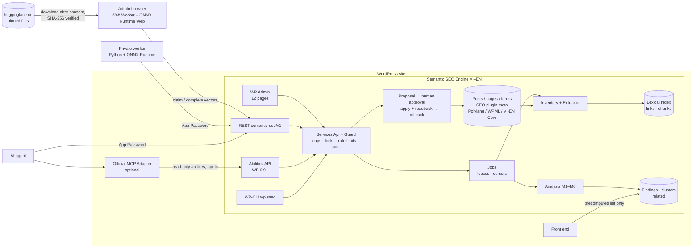

# Architecture — Semantic SEO Engine VI–EN

This document is the engineering blueprint written before implementation (README §2.8) and kept in sync with the code. Section numbers in brackets refer to the master README.

## 1. Guiding constraints

* **Read-only by default.** Activation only creates the plugin's own tables and one settings option. No WordPress content, SEO metadata, permalinks, menus, theme files or other plugins' options are written on activation, and no scan is started automatically.
* **One service layer, three transports.** WP Admin pages, the REST API (`/wp-json/semantic-seo/v1`), WordPress Abilities (WP 6.9+) and WP-CLI all call the same `SemanticSEO\Services\*` classes. Permission checks, locks, rate limits, approvals and audit logging live in that layer, so no transport can bypass them.
* **Evidence, not verdicts.** Every finding stores separate evidence components, an algorithm version, a label (`verified_error`, `warning`, `suggestion`, `risk_hypothesis`) and a confidence *category* (`high`, `medium`, `low`, `manual_review`). No fabricated percentages.
* **Tier 0 always works.** All six modules run in lexical/deterministic mode on shared hosting. Embeddings (Tier 1 browser, Tier 2 private worker) only add an extra evidence component.

## 2. Component map

```
semantic-seo-engine-vi-en.php   bootstrap: requirements gate → Autoloader → Plugin::instance()
includes/
  Plugin.php                    wires hooks, version gates (Abilities ≥ WP 6.9, MCP adapter optional)
  Capabilities.php              sseo_read / sseo_analyze / sseo_review / sseo_apply / sseo_manage + agent roles
  Settings.php                  single non-autoloaded option, schema-validated, defaults = read-only
  Database/                     Schema (tables), Migrator (versioned, idempotent, lock + log)
  Security/                     AuthContext (admin/cookie/app-password/cli/cron), RateLimiter, UrlGuard (SSRF), Mutex
  Language/                     Normalizer (NFC, accent folding), LanguageDetector (VI/EN), Polylang/WPML/Nguyen Ha VI-EN Core/URL-prefix/default adapters (read-only), Places (Vietnamese place names in titles)
  Compatibility/                SEO plugin adapters (Yoast, Rank Math, SEOPress, TSF, AIOSEO, core) + environment detection
  Extractor/                    HtmlScanner (offset-preserving text segments), ContentExtractor (headings, links, chunks, MinHash)
  Lexical/                      Tokenizer (syllable unigrams, accent-folded tokens, bigrams), LexicalIndex (BM25F-lite postings)
  Semantic/                     ModelProfile (pinned Qwen3 revision + hashes, per-precision self-test matrices), VectorMath, EmbeddingRepository, EmbeddingQueue (leases), CrossLanguage (mutual-nearest possible translations), SimilarityBaseline (site median similarity per language), DeviceVerification (server-side check of a device's self-test vectors before any upload)
  Inventory/                    InventoryScanner (cursor batches over posts/pages/CPT/terms), DocumentRepository
  Graph/                        LinkGraph (edge resolution, inbound/outbound, orphans with coverage)
  Analysis/                     IntentClassifier, Scorer (per-task features), FindingRepository, AnalysisRunner (phased, resumable)
  Links/                        LinkSuggester (anchor discovery with byte offsets + fingerprints)   [M2]
  Cannibalization/              CannibalizationAnalyzer (pair classification + grouping)            [M3]
  Clustering/                   ClusterBuilder (taxonomy-first Pillar/Hub/Silo/Supporting), ClusterTree [M4]
  Quality/                      QaChecker (rules with verified/warning/suggestion labels)          [M5]
  Recommendations/              RelatedContent (precomputed, MMR diversity), shortcode, block, PHP API [M6]
  Matrix/                       MatrixQuery (server-side paging/filter/sort), CSV export (UTF-8 BOM), import preview
  Gsc/                          Import of genuine Search Console CSV exports (page, query, metrics, period, source)
  Jobs/                         JobRepository, JobRunner (leases, heartbeat, cursor, retry/backoff, cancel/pause)
  Approval/                     ProposalService (exact diff + diff hash), ApprovalService (human-only, single use, expiry),
                                ChangeExecutor (mutex, stale check, snapshot, write, readback verify, auto-revert), Operations
  Rollback/                     RollbackService (exact / surgical / manual-recovery)
  Locks/                        LockService (document, cluster and URL-pattern locks/exclusions)
  Audit/                        AuditLog (redacted, IP hashed, retention)
  Services/                     Api (business façade used by every transport), Guard (capability + rate limit + audit)
  Support/                      Util (canonical JSON, hashing, cursors)
  REST/                         RestController (schema-validated routes, cursor pagination, envelopes, 429s)
  Abilities/                    AbilitiesRegistrar (15 abilities, JSON Schemas, opt-in exposure, MCP read-only only)
  Cli/                          `wp sseo …` commands
admin/                          12 server-rendered admin pages, responsive CSS, progressive-enhancement JS
assets/js/ai-worker/            Web Worker + embedding core (last-token pooling, L2, MRL truncation, sha256 verification)
assets/vendor/transformers/     bundled @huggingface/transformers web build + onnxruntime-web WASM (no model weights)
templates/related-content.php   overridable frontend template
languages/                      POT + complete Vietnamese translation (.po/.mo)
tools/private-worker/           optional Tier 2 Python worker (ONNX Runtime CPU; not shipped in the ZIP)
tools/i18n/                     translation tables and the .po builder (not shipped)
tests/                          PHPUnit (unit + WordPress integration), JS unit, e2e (Playwright, HTTP, ZIP smoke), bench
```

### Architecture diagram



## 3. Data flow: READ → ANALYZE → PROPOSE → APPROVE → APPLY → VERIFY [§7]

1. **Inventory job** walks objects with an ID cursor (`WHERE ID > cursor ORDER BY ID LIMIT batch`), never loading the whole site. For each object it records locale + provenance, canonical/robots from the detected SEO adapter, taxonomy, translation group, content hash; re-extracts and re-indexes only when the hash changed.
2. **Analyze job** runs resumable phases: `graph` (resolve link targets) → `vectors` (lexical TF-IDF vectors, intent, topics) → `clusters` (taxonomy tree, recommended pillar/hub using links from and to the whole subtree) → `pairs` (BM25 candidate retrieval + cluster mates + ancestor pillars, then link suggestions, overlap classification and related content per document) → `qa` → `finalize` (grouping, orphan coverage, summary). Clusters run before pairs so roles are known on the first run.
3. **Embeddings** (optional) are queued per document summary/chunk; the browser worker or private worker claims leased items via REST, computes vectors with the pinned model and uploads them. Every vector stores `model_id, revision, dtype, dimension, preprocess_version, locale, content_hash`; a profile change makes old vectors ineligible automatically.
4. **Proposals** are created from findings (e.g. an internal-link suggestion) as an exact diff against a recorded base content hash; `diff_hash = sha256(canonical JSON)`.
5. **Approval** can only be created by a human in WP Admin (cookie session + nonce + `sseo_review`), never through Application Passwords or Abilities. It binds proposal ID, object IDs, diff hash, action category, approver and expiry, and is single-use.
6. **Apply** (human in Admin, or an agent account explicitly allowed by the administrator) atomically consumes the approval, takes an object mutex, re-checks the base hash, snapshots, writes with `wp_update_post`, reads back and verifies the expected hash, auto-reverts on mismatch and logs everything with an idempotency key.
7. **Rollback** restores the snapshot when the object is unchanged since apply; otherwise performs a verified surgical revert or reports that manual recovery is needed.

## 4. Storage [§12]

Custom tables (prefix `{$wpdb->prefix}sseo_`), versioned by `Database\Schema::VERSION` and migrated with `dbDelta` plus explicit, idempotent steps recorded in `sseo_migration_log`:

| Table | Purpose |
| --- | --- |
| documents | one row per WP object (post/page/CPT/term): URL, locale+provenance, status, canonical, robots, SEO source, translation group, hashes, intent, cluster role, review state, lexical vector, MinHash signature |
| chunks | heading-aware chunks with byte offsets and hashes |
| postings | lexical index (term, doc, weighted tf) with binary collation so Vietnamese accents are never merged by MySQL collation |
| links | observed link edges with anchor, byte offset, fingerprint, resolution status |
| embeddings | packed float32 vectors + full model provenance |
| queue | embedding work items with leases |
| findings | analyses/recommendations with evidence JSON, label, confidence category, status |
| related | precomputed related-content lists |
| clusters | Pillar/Hub/Silo tree with locks and versions |
| jobs | queued/running/paused/failed/completed/cancelled jobs with lease, heartbeat, cursor, progress |
| proposals | exact diffs and their lifecycle |
| approvals | human approvals (single-use, expiring) |
| changes | before/after snapshots, idempotency keys, verification results |
| audit | redacted action history |
| locks | locks/exclusions for documents, clusters and URL patterns |
| gsc | genuinely imported Search Console rows (page, query, metrics, period, source, import id) |

Deactivation keeps everything. `uninstall.php` keeps data unless the administrator explicitly selected the "delete all plugin data" policy in Settings (double confirmation). Derived data (index, findings, embeddings) can be rebuilt from WordPress content at any time without writing posts.

## 5. Scoring [§5]

Each task returns separate components plus `algorithm_version`:

* **Link relevance** = locale gate × crawl validity gate × (lexical cosine, BM25 rank, semantic cosine when available, anchor quality, graph usefulness [low inbound / orphan target / supporting→pillar]).
* **Cannibalization** = same-locale gate; classification by MinHash near-duplicate score, title/heading overlap, lexical and semantic similarity, intent agreement, explicit focus keyword, cluster roles, distinct facet modifiers (e.g. *theo ngày* vs *theo tháng*), and real GSC query overlap when imported. Ambiguous pairs → `manual_review`.
* **Semantic similarity in two forms.** Ranking (link candidates, related content) uses the raw cosine. The overlap-risk gate uses a *calibrated* value: only the similarity above a floor counts, `(cos − floor) / (ceiling − floor)`. The floor is the model's own (0.40, measured on the labelled fixture) raised to the **site's median same-language similarity** when that is higher (`Semantic\SimilarityBaseline`, re-measured on a deterministic sample of ≤ 20,000 pairs per language at every site-wide analysis, bound to the model key). Measured on the read-only copy of the blog (1,081 pages): with raw cosine the overlap report grew from 99 groups (lexical) to 2,323; with the calibrated gate it has 898, whose pairs are all among the ~1% most similar pairs of the site (reported pairs: cosine p10 0.68; the site's own p99 0.68). The blog's medians (VI 0.38, EN 0.36) are below the model floor, so there the model floor applies; the site baseline protects sites whose pages are more alike than the fixture. Every overlap finding records the calibration it used (`evidence.calibration`).
* **Overlap categories after the real-site pilot.** Titles that name different places (Hà Giang vs Sa Pa, Hoàn Kiếm vs Long Biên) are *distinct facets*; *different intent* and *pillar + supporting* are information, not risk; pairs whose only evidence is vector similarity stay *manual review* with confidence `low` (`evidence.basis = semantic_only`). Duplicates, a shared focus keyword and Search Console overlap are decided first; translations are never compared.
* **Classification** = taxonomy anchors (existing categories) + lexical/semantic centroid similarity + editorial intent.
* **Related content** = locale gate + topical relevance + cluster bonus + MMR diversity + exclusion/canonical/noindex rules.

Thresholds and weights are configurable in the Expert panel; defaults are documented in `docs/PERFORMANCE.md` together with the measured evaluation results on the labelled VI/EN fixture set.

## 6. Threat model summary [§14]

Full model in `docs/SECURITY.md`. Key decisions:

* Every REST route has a `permission_callback`; admin forms use nonces; all SQL uses `$wpdb->prepare`; all output is escaped.
* Agent identities (dedicated roles or any Application-Password-authenticated request) can never hold `sseo_review`/`sseo_manage`; `sseo_apply` for agents is off unless the administrator enables "agents may execute already-approved changes".
* No endpoint accepts arbitrary PHP, SQL, shell, file paths, option names or URLs outside the site's own host (UrlGuard).
* Approvals are human-only, single-use (atomic `UPDATE … WHERE status='active'`), expiring and bound to the diff hash; apply uses idempotency keys and an object mutex.
* Rate limits per user and route class; page-size caps; payload size caps on embedding uploads.
* Frontend output contains only precomputed, escaped links; no model, no admin data, no inference.

## 7. Performance budget [§15]

* No model code on public pages; the frontend only renders a cached list when M6 is explicitly enabled.
* Jobs process bounded batches (default 25 objects) under a time budget (default 20 s) with leases and resumable cursors; WP-Cron only schedules short ticks, admin pages can drive ticks when WP-Cron is disabled, and WP-CLI can run jobs to completion.
* Pair analysis uses the inverted index to retrieve top-K candidates per document instead of naive all-pairs.
* Matrix and REST responses are paginated server-side (max 100 rows).
* Measured numbers (not estimates) are recorded in `docs/PERFORMANCE.md`.

## 8. Proof-of-concept results

Recorded in `docs/TEST-REPORT.md` with the exact commands used; raw JSON results are in `docs/evidence/`.
